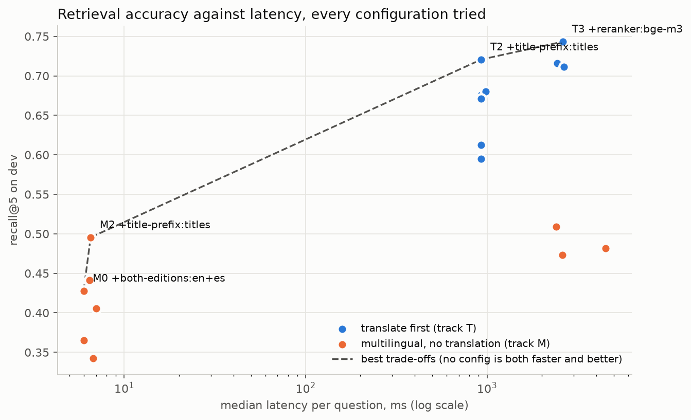

# Phase 4 results: which retrieval change won

Every number on this page comes from two commands run on 2026-10-18:
`uv run python -m atr.eval.ablation` (writes `docs/ablation.txt`, the full table) and
`uv run python -m atr.eval.plot` (writes `docs/figures/accuracy_latency.png` and prints the
trade-off front). Both read the committed records under `runs/ablation/`. The question set is
`1654d35d3dad`, frozen with 112 of 112 groups still without a human review (DECISIONS.md D18),
which makes every number here provisional until mannie reviews the set and re-freezes it.

## What was measured

Dev split only: 111 questions with a gold passage, from 37 question groups, each group being one
question in English, Spanish and code-switched Spanish-English. The primary metric is recall@5
(is a gold passage among the top 5). Intervals are 95% percentile bootstraps that resample
question groups, not questions, with 10000 resamples and seed 0.

The rule was fixed before any run (D29): a change is kept only when the 95% interval of its
paired difference against the current best is entirely above zero. Six changes were tried in a
fixed order on two tracks, each track carrying its own current best:

- **Track T** (translate first): `bge-small-en-v1.5` over the English edition, with Spanish and
  code-switched questions translated to English by a local `qwen2.5:14b`.
- **Track M** (multilingual, no translation): `multilingual-e5-small` over the English edition.

Latency is per question with every stage summed, measured on an Apple M5 Pro with 24 GB. The
LLM stages replay the time each cached call really cost (D27, D34).

## Track T: the title prefix won, for free

| step | variant | recall@5 | base | difference [95%] | p50 ms | decision |
|---|---|---|---|---|---|---|
| start T0 | dense-en + translate | 0.61 | | | 930.2 | |
| hybrid | RRF with BM25 | 0.59 | 0.61 | -0.02 [-0.13, +0.09] | 929.7 | dropped |
| title prefix | law and section title before each passage | 0.72 | 0.61 | +0.11 [+0.03, +0.20] | 931.7 | **kept** |
| reranker | MiniLM cross-encoder, top 20 | 0.68 | 0.72 | -0.04 [-0.11, +0.04] | 993.4 | dropped |
| reranker | bge-reranker-v2-m3, top 20 | 0.74 | 0.72 | +0.02 [-0.06, +0.10] | 2202.4 | dropped |
| chunking | word-limited blocks | 0.68 | 0.72 | -0.05 [-0.11, +0.01] | 934.2 | dropped |
| chunking | one chunk per list item | 0.67 | 0.72 | -0.05 [-0.12, +0.01] | | dropped |
| rewrite | rulebook vocabulary | 0.71 | 0.72 | -0.01 [-0.11, +0.10] | | dropped |
| decompose | sub-questions | 0.69 | 0.72 | -0.03 [-0.10, +0.04] | 2432.5 | dropped |

Final T2 (translate, `bge-small-en`, title prefix): recall@5 **0.72 [0.59, 0.84]**, recall@1
0.40, MRR 0.57, nDCG@10 0.60, total p50 931.7 ms of which translation is 924.4 ms and the dense
search 5.6 ms.

By question type at T2: plain 0.96, scenario 0.85, multi_rule 0.67, false_premise 0.58,
paraphrase 0.44. By language: English 0.73, Spanish 0.76, code-switched 0.68.

The bge-m3 reranker scored higher (0.74) but its interval covers zero and it more than doubles
the latency, which is exactly the case the rule exists for. It is still reported in the table
and the plot for mannie to overrule if he wants the extra two points.

## Track M: the rulebook rewrite won, at a price

| step | variant | recall@5 | base | difference [95%] | p50 ms | decision |
|---|---|---|---|---|---|---|
| start M0 | dense-multi | 0.41 | | | 6.4 | |
| both editions | index EN and ES | 0.43 | 0.41 | +0.02 [-0.06, +0.10] | 5.6 | dropped |
| hybrid | RRF with BM25 | 0.44 | 0.41 | +0.04 [-0.06, +0.13] | 5.8 | dropped |
| title prefix | law and section title before each passage | 0.50 | 0.41 | +0.09 [-0.00, +0.19] | 6.2 | dropped |
| reranker | bge-reranker-v2-m3, top 20 | 0.47 | 0.41 | +0.07 [-0.02, +0.15] | 1233.2 | dropped |
| chunking | word-limited blocks | 0.36 | 0.41 | -0.04 [-0.10, +0.02] | 8.5 | dropped |
| chunking | one chunk per list item | 0.34 | 0.41 | -0.06 [-0.15, +0.03] | | dropped |
| rewrite | rulebook vocabulary | 0.51 | 0.41 | +0.10 [+0.02, +0.19] | 2415.2 | **kept** |
| decompose | sub-questions | 0.46 | 0.51 | -0.05 [-0.10, +0.01] | 4525.0 | dropped |

Final M5 (`multilingual-e5-small`, rulebook rewrite): recall@5 **0.51 [0.39, 0.63]**, recall@1
0.27, MRR 0.39, nDCG@10 0.43, total p50 2415.2 ms of which the rewrite is 2407.2 ms.

By type at M5: plain 0.85, scenario 0.52, false_premise 0.42, paraphrase 0.33, multi_rule 0.31.
By language: English 0.64, code-switched 0.47, Spanish 0.42.

The title prefix missed on track M by the thinnest margin the rule allows (the interval's low
end is -0.00). It is the cheapest good configuration on the plot (0.50 at 6.2 ms) even though
the rule did not keep it.

## Accuracy against latency

The trade-off front printed by `atr.eval.plot`, fastest first:

| configuration | p50 ms | recall@5 |
|---|---|---|
| M0 + both editions | 5.6 | 0.43 |
| M1 + hybrid RRF | 5.8 | 0.44 |
| M2 + title prefix | 6.2 | 0.50 |
| T2 + title prefix | 931.7 | 0.72 |
| T3 + bge-m3 reranker | 2202.4 | 0.74 |

## Reading

1. **Putting the law and section title in front of each passage was the one change that paid
   for nothing.** It moved track T from 0.61 to 0.72 with no latency cost, and it was the best
   cheap configuration on track M as well. Passages in the Laws often do not repeat the concept
   their section is about ("Offside position" is in the heading, not the paragraph), and the
   title puts that word back where the embedding can see it.
2. **Translate-first beats multilingual by a wide margin, but the two tracks also use different
   encoders.** T0 starts 0.20 above M0, and that gap mixes two things: the translation step and
   `bge-small-en` against `multilingual-e5-small`. Phase 5 (fine-tuning the multilingual
   encoder) is the attempt to close the gap from the M side without paying for translation.
3. **Everything that costs an LLM call at query time is expensive here.** Translation is 0.92 s
   per question, the rewrite 2.4 s, decomposition 4.5 s on the M5 Pro. The rewrite bought track
   M ten points; decomposition bought nothing on either track.
4. **Chunking hurt both tracks.** Smaller units lose the context a passage-level gold label
   rewards; with chunk-level labels the result might differ, but that is not what this set
   measures.
5. **Rerankers did not clear the bar.** bge-m3 gained two points on T and six on M, both inside
   the noise of 37 groups, at more than a second per question.
6. **Paraphrases are the weak spot on both tracks** (0.44 on T, 0.33 on M), and Spanish is
   where the multilingual encoder loses the most (0.42 against 0.64 for English on M5).

## Caveats

- Provisional: the question set has not been reviewed by a native speaker, and every number is
  on dev. The test split stays barred (D18).
- 37 groups is a small sample; most intervals span twenty points or more. The rule is strict
  on purpose, and several "dropped" changes may be real but unprovable at this size.
- Two stages were repaired after the first results had been seen (the decomposition parser and
  the rewrite's script check, D38). Both were rerun under the same rule, and the first results
  remain in git history at commit `c392276`.
- The latencies were re-measured on 2026-10-18 when the records were regenerated under the
  phase 5 code stamp; every ranked list was identical to the 2026-10-07 regeneration.
